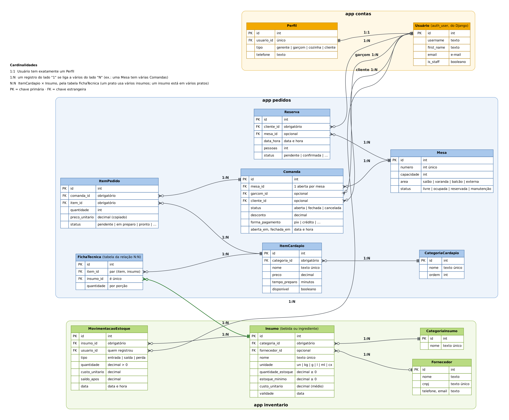

# GestorBar — Sistema de Gestão para Bares e Restaurantes

Aplicação web em Django para gerir **mesas e comandas**, o **cardápio** (com ficha técnica de cada prato) e o **estoque** de bebidas e ingredientes, com baixa automática no estoque sempre que uma conta é fechada.

Trabalho prático da disciplina **GAC116 – Programação Web** (UFLA).

## Integrantes

| Integrante | Responsabilidade principal |
|---|---|
| Maria Rita Ribeiro Resende | Estrutura do projeto, app `contas` (perfis e permissões), templates e documentação |
| Brenda Moreira da Silva | App `inventario` (insumos, fornecedores, movimentações de estoque) |
| Clarisse Lacerda Pimentel | App `pedidos` (cardápio, mesas, comandas, reservas) e dados de exemplo |

## Descrição

O GestorBar organiza a operação de um bar ou restaurante:

- o **garçom** abre uma comanda para a mesa e lança os itens pedidos;
- a **cozinha/bar** acompanha a fila de preparo e marca cada item como em preparo, pronto ou entregue;
- ao **fechar a comanda**, o sistema calcula subtotal, taxa de serviço (10%) e desconto, registra a forma de pagamento, libera a mesa e dá **baixa no estoque** de cada insumo usado, conforme a ficha técnica dos itens;
- o **gerente** controla o cardápio, os fornecedores e o estoque, com alertas de estoque mínimo e de validade.

## Tecnologias

- Python 3.12+
- Django 5.2
- Django Jazzmin (tema do painel administrativo, com modo claro/escuro)
- Bootstrap 5.3 e Bootstrap Icons (área pública, responsiva, com tema claro/escuro)
- SQLite (banco relacional)

## Instalação

```bash
git clone https://github.com/<usuario>/<repositorio>.git
cd <repositorio>

python -m venv venv
# Linux/macOS
source venv/bin/activate
# Windows
venv\Scripts\activate

pip install -r requirements.txt
python manage.py migrate
python manage.py popular_dados      # perfis, permissões e dados de exemplo
python manage.py createsuperuser    # seu usuário administrador
```

## Execução

```bash
python manage.py runserver
```

- Página inicial: http://127.0.0.1:8000/
- Painel administrativo: http://127.0.0.1:8000/admin/

Testes automatizados:

```bash
python manage.py test
```

### Usuários de exemplo

Criados por `popular_dados`, todos com a senha `senha123`:

| Usuário | Perfil | Acesso |
|---|---|---|
| `gerente` | Gerente | Tudo no painel |
| `garcom1`, `garcom2` | Garçom | Mesas, comandas, itens dos pedidos e reservas |
| `cozinha` | Cozinha/Bar | Fila de preparo, cardápio e consulta/entrada de estoque |
| `cliente1`, `cliente2` | Cliente | Área do cliente (Checkpoint 2) |

## Principais funcionalidades

**Perfis e permissões (`contas`)**
- Todo usuário recebe um perfil automaticamente (superusuário vira gerente; os demais, cliente).
- Trocar o perfil coloca o usuário no grupo certo e libera ou bloqueia o acesso ao painel.
- Comando `configurar_perfis` cria os grupos Gerente, Garçom, Cozinha/Bar e Cliente com suas permissões.

**Estoque (`inventario`)**
- Cadastro de fornecedores, categorias e insumos (bebidas e ingredientes) com unidade, estoque mínimo, custo e validade.
- Movimentações de entrada, saída e perda; o saldo só muda por movimentação e cada registro guarda o saldo resultante, formando um histórico imutável (não pode ser editado nem excluído).
- Impede saldo negativo e recalcula o custo médio ponderado do insumo a cada compra.
- Baixa em lote "tudo ou nada": ao fechar uma comanda, ou todos os insumos são baixados, ou nenhum.
- Ações no admin para baixar insumos vencidos como perda e gerar a lista de compras dos itens abaixo do mínimo.
- Filtros por situação do estoque (zerado / abaixo do mínimo / normal), validade (vencido, vence em 7 ou 30 dias, sem validade), período das movimentações, categoria e fornecedor.

**Pedidos (`pedidos`)**
- Cardápio com categorias, preço, tempo de preparo e ficha técnica; o painel mostra custo, margem e se há estoque para preparar.
- Mesas por área, com status (livre, ocupada, reservada, manutenção) atualizado automaticamente pelas comandas.
- Comandas com uma única comanda aberta por mesa, preço do item congelado no momento do pedido, taxa de serviço e desconto.
- Ações para fechar (com baixa de estoque) ou cancelar comandas e para mudar o status dos itens na fila da cozinha.
- Reservas com validação de capacidade da mesa e de conflito de horário.
- Filtros por valor consumido, fila de preparo/atrasados, faixa de preço, período da reserva, garçom, área e datas.

**Painel administrativo**
- Tema Jazzmin com logo próprio, ícones, menu superior e abas nos formulários.
- Tela de login personalizada, com a marca e uma comanda de exemplo mostrando a baixa no estoque.
- Ações em massa (fechar comanda, marcar item como pronto etc.) liberadas só para quem tem permissão de alteração.
- Tema claro/escuro: segue o sistema operacional e tem um botão flutuante (canto inferior direito) para trocar manualmente.
- Página inicial do painel personalizada com cartões de resumo: mesas ocupadas, comandas abertas, faturamento do dia, fila da cozinha e insumos a repor.

## Modelagem do banco de dados



Como ler o diagrama:

- As tabelas estão agrupadas pelo app a que pertencem (`contas`, `inventario` e `pedidos`).
- Cada linha liga uma chave estrangeira (FK) à chave primária (PK) da tabela relacionada e traz escrita a cardinalidade.
- **1:1:** `Usuário` e `Perfil` (cada usuário tem exatamente um perfil).
- **1:N:** as demais ligações. Exemplos: uma `Mesa` tem várias `Comanda`s; uma `Comanda` tem vários `ItemPedido`s; um `Insumo` tem várias `MovimentacaoEstoque`s.
- **N:N:** `ItemCardapio` e `Insumo`, por meio da tabela `FichaTecnica` (um prato usa vários insumos, e um insumo está em vários pratos).
- Nas pontas das linhas, o "pé de galinha" indica o lado "muitos", o traço duplo o lado "um" e o círculo que a relação é opcional.
- A linha verde é a ligação entre os apps `pedidos` e `inventario`: a ficha técnica diz quanto de cada insumo vai em uma porção, e é ela que permite dar baixa no estoque quando a comanda é fechada.

O código-fonte do diagrama está em `docs/modelagem.dot` (Graphviz).

## Estrutura do projeto

```
.
├── config/                 # configurações, URLs, WSGI/ASGI
├── docs/                   # diagrama do banco (modelagem.png e modelagem.dot)
├── contas/                 # app de perfis de usuário
│   ├── management/commands/configurar_perfis.py
│   ├── admin.py  models.py  signals.py  tests.py
├── inventario/             # app de estoque (bebidas e ingredientes)
│   ├── admin.py  models.py  utils.py  tests.py
├── pedidos/                # app de cardápio, mesas, comandas e reservas
│   ├── management/commands/popular_dados.py
│   ├── templatetags/painel.py
│   ├── admin.py  formatacao.py  models.py  tests.py
├── templates/
│   ├── admin/index.html    # painel inicial do admin com cartões de resumo
│   ├── admin/login.html    # título da tela de login do painel
│   ├── registration/       # layout das telas de login, saída e senha
│   ├── base.html           # layout Bootstrap com tema claro/escuro
│   └── home.html           # página inicial pública
├── static/
│   ├── css/                # admin.css, login.css, estilo.css
│   ├── img/                # logo do GestorBar
│   └── js/                 # tema.js e admin_tema.js (alternância de tema)
├── manage.py
├── requirements.txt
└── README.md
```

## Fluxo de branches

- `main`: versão entregue/apresentada.
- `develop`: integração do que está pronto.
- `feature`: desenvolvimento das funcionalidades; entra em `develop` por pull request.
